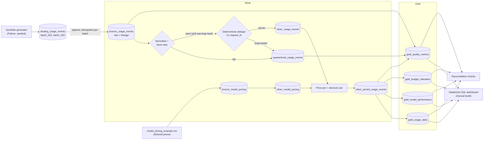

# LLM Usage and Cost Intelligence Platform

A Databricks lakehouse (PySpark · Delta Lake · Spark SQL, Bronze/Silver/Gold) that turns **synthetic** LLM request
logs into validated, cost-enriched, reconciled analytics.

> **Everything here is synthetic.** The request data is generated, providers and models are fictional, and all
> prices are **illustrative, not real provider pricing**. Numbers in this README demonstrate that the pipeline
> works. They are not cost savings, benchmarks or production results. The project analyses recorded usage; it never
> calls an LLM or any external API.

## Status (what has and has not been verified)

| Item | Status |
|---|---|
| Generator, validation, dedup, pricing, Gold metrics, incremental logic | ✅ run locally (Spark 4.2, Java 17) |
| Unit/integration tests | ✅ see [Test results](#test-results) |
| End-to-end local run + all `sql/*.sql` statements | ✅ [`evidence/local_validation_results.txt`](evidence/local_validation_results.txt) |
| Notebooks `00`–`05` inside Databricks Free Edition (Delta tables, serverless) | ⚠️ **not yet executed**: written for it, never run there. Checklist: [`docs/databricks_validation.md`](docs/databricks_validation.md) |
| Databricks SQL dashboard | ❌ not built (spec + queries only: [`dashboards/dashboard_spec.md`](dashboards/dashboard_spec.md)) |
| `architecture.png` | ❌ not rendered (source is [`architecture/architecture.mmd`](architecture/architecture.mmd), shown below) |

## Business problem
Teams run chatbots, agents, coding assistants and document processors on LLMs. Each request consumes input/output
tokens, has a model-specific cost, latency and outcome, and may be retried. Usage records arrive duplicated, late
or malformed. The platform answers: who spends most (team/application/model)? input vs output cost? which apps have
high failure rates or latency? are duplicates inflating cost? which apps are nearing budget? how does spend change
over time? and can a new batch be processed without double counting?

## Architecture (intended design)


## Stack
Python 3.10+ · PySpark (Spark 4 locally; Databricks serverless target) · Delta Lake · Spark SQL · Unity Catalog
(catalog/schema are configurable) · pytest · GitHub. No external services, keys, Kafka, or paid APIs.

## Repository layout
```
src/llm_cost_intelligence/  config, schemas, data_generator, validation, deduplication,
                            pricing, transformations, incremental, metrics, local
notebooks/                  00_setup, 01_generate_data … 05_gold_analytics (Databricks source format)
sql/                        4 query files (cost, model performance, data quality, budgets)
tests/                      pytest suite   ·   scripts/  generate_sample_data.py, validate_project.py
config/                     project.example.yml, model_pricing_example.csv
docs/  dashboards/  evidence/  architecture/
```
Business logic lives once, in `src/`; notebooks only orchestrate and assert.

## Synthetic dataset
`batch_001`: 20,000 requests (seed 42) over 30 days (Jan 2025) + injected defects, 20,200 rows total.
`batch_002`: 2,180 rows: 2,000 new on-time requests, 30 late-arriving, 100 exact re-deliveries, 50 corrections.
Teams: customer_support, engineering, finance, operations, product. Applications: support_assistant,
code_assistant, document_summarizer, internal_knowledge_assistant. Fictional provider/model pairs, one of which
(`provider_gamma/model_experimental`) intentionally has **no price**.

Injected into batch 1 (deterministic; asserted by tests against an independent oracle):

| Defect | Rows | Expected outcome |
|---|---|---|
| Missing required field (id/team/app/provider/model/timestamp) | 100 | quarantined |
| Negative token count | 60 | quarantined |
| Invalid status | 60 | quarantined |
| Unparseable timestamp | 40 | quarantined (56 `invalid_timestamp` reasons incl. the missing-timestamp rows) |
| Exact + conflicting duplicate deliveries | 100 + 100 | 200 superseded → quarantine |
| High latency (60–180 s) | 100 | **kept**, warning `high_latency` |
| Padded/mixed-case strings | 50 | **kept**, normalised |
| Unpriced model | ~7% of rows | kept, `billing_status = unpriced`, NULL cost |

Expected after batch 1: **20,200 Bronze → 19,740 Silver + 460 quarantine (260 validation + 200 superseded)**.
After batch 2: **22,380 Bronze → 21,770 Silver + 610 quarantine** (350 superseded). Matches the run below.

## Layers
- **Bronze**: raw rows exactly as delivered (timestamp kept as string), plus `_record_hash`, `_source`,
  `_bronze_loaded_at`. Append-only; replaying a batch inserts 0 rows.
- **Silver**: normalise → hard-rule validation → deterministic dedupe → pricing → cost. Invalid and superseded rows
  go to `quarantined_usage_events` with reasons, category, winner hash and the raw JSON payload.
- **Gold**: `gold_usage_daily` (additive facts), `gold_model_performance` (p95, failure rate, cost per success),
  `gold_budget_utilization` (synthetic budgets), `gold_quality_metrics`. Team/application/cost-trend views are SQL over `gold_usage_daily`.

Schemas: [`docs/data_dictionary.md`](docs/data_dictionary.md).

## Cost formula and billing assumptions
```
input_cost  = input_tokens  * input_price_per_million_tokens  / 1,000,000
output_cost = output_tokens * output_price_per_million_tokens / 1,000,000
total_estimated_cost = input_cost + output_cost          # DECIMAL(18,8), prices DECIMAL(12,6)
```
Effective-dated pricing (provider + model + request date). Unpriced → NULL cost (never 0); `rate_limited` →
explicit `not_billed` 0; failed requests billed on recorded tokens; retries add no multiplier (tokens already cover
all attempts); cache hits billed normally; duplicates never billed twice.
This is a **synthetic convention**. Details and limits: [`docs/cost_calculation.md`](docs/cost_calculation.md).

## Data quality, dedup and incremental design
Hard rules vs soft warnings, the winner policy (`ingested_at` → `batch_id` → `_record_hash`), what each count
means and why `bronze = silver + quarantine` holds exactly: [`docs/data_quality_rules.md`](docs/data_quality_rules.md).
Silver/Gold are full-refresh from Bronze (simple, correct at this scale, not for very large history).

## SQL analytics
`sql/01_cost_analysis.sql` (daily/model/team/app cost, input vs output, tokens, spikes, cache hits),
`02_model_performance.sql` (failure rate, avg/p95 latency, retries), `03_data_quality.sql` (quarantine, pricing
coverage, audit), `04_budget_monitoring.sql`. Every metric states its denominator in a comment.

## Actual results (local run, synthetic data, fictional prices)
From [`evidence/local_validation_results.txt`](evidence/local_validation_results.txt), after batches 1 and 2:

| Check | Result |
|---|---|
| Bronze / Silver / Quarantine rows | 22,380 / 21,770 / 610 |
| Batch replay | 20,200 → 20,200 rows (nothing inserted) |
| Pricing coverage | 19,936 priced · 1,415 unpriced · 419 not billed (rate-limited) |
| Total estimated cost (priced only) | 109.70064685 (illustrative units) |
| Reconciliation checks | 14 / 14 pass (rows, tokens, and exact decimal cost, Silver ↔ Gold) |
| SQL statements executed | 26 / 26 run without error (row counts logged) |

## Test results
`python -m pytest -v` on the author's machine (Windows, Python 3.13, PySpark 4.2.0, Java 17):
**63 passed, 0 failed, 0 skipped, 1 warning (a pandas 3 `FutureWarning` from PySpark) in 1,112 s (18 min 31 s)** (full log: [`evidence/pytest_results.txt`](evidence/pytest_results.txt)).
An earlier full run had 1 failure (budget stored with 2 decimals rounded a test value); it was fixed and the suite rerun.
The suite was rerun after a generator fix (`n_requests=100` previously crashed batch 2) and a new regression test; `validate_project.py` was rerun too and its output is unchanged.
Coverage: generator (reproducibility, defect counts), validation rules, dedup (exact/conflicting/order-independent/retries),
pricing (manual cost, zero tokens, decimals, missing price, effective dates, invalid/overlapping config), Gold metrics,
Silver↔Gold reconciliation, and incremental batches (replay, late, corrections).

Not covered by tests: anything that needs Delta/Unity Catalog/serverless (run notebooks 01–05 to verify).

## Setup and run

**Local** (Java 17+ required for Spark 4; set `JAVA_HOME`):
```bash
pip install -r requirements-dev.txt
python -m pytest -q                          # make test  (slow: ~15 min on a laptop)
python scripts/validate_project.py --out evidence/local_validation_results.txt   # make validate
python scripts/generate_sample_data.py --rows 100 --out sample_data             # make generate-data (no Spark)
```
`make` targets mirror these commands (`make` itself was not run). `make lint` needs `ruff`, which was not run.

**Databricks Free Edition** (steps below are untested in a real workspace):
1. Push this repo to GitHub; in Databricks: *Workspace → Create → Git folder* and paste the repo URL. (`src/` must
   sit beside `notebooks/`; `00_setup` adds it to `sys.path`.)
2. Open `notebooks/01_generate_data` and attach **Serverless** compute. Set the `catalog` widget to a catalog where
   you may create schemas (default `workspace`; the schema defaults to `llm_usage`). Use `n_requests=100` for a quick trial.
3. Run in order: `01_generate_data` → `02_bronze_ingestion` (`batch_id=batch_001`) → `03_silver_validation` →
   `04_cost_enrichment` → `05_gold_analytics`. Notebook 05 fails if reconciliation fails.
4. Incremental demo: set `batch_id=batch_002`, rerun `02`, then `03` → `05`. Rerun `02` again to see 0 rows inserted.
5. Dashboard: follow [`dashboards/dashboard_spec.md`](dashboards/dashboard_spec.md); then add real screenshots to `evidence/`.

Overwrite behaviour: `01` overwrites the landing table; `02` appends to Bronze (pricing config table overwritten);
`03`–`05` overwrite Silver/priced/Gold tables. Tables live only in your target schema; nothing outside it is touched.

## Known limitations
- Synthetic data and fictional prices; the billing convention is an assumption, not any real provider's.
- Not yet executed in Databricks; no dashboard built; no PNG diagram.
- Silver/Gold are full refreshes (no Delta `MERGE`); Bronze idempotency uses an anti-join, not `MERGE`.
- `unpriced` requests are excluded from cost totals and budget utilization (reported separately).
- Local tests run on plain Spark, not Delta; Spark tests are slow.
- Windows/Java 17 locally; no CI configured.

## Future enhancements
Delta `MERGE` for incremental Silver · Auto Loader / Structured Streaming ingestion · Lakeflow Jobs orchestration ·
anomaly detection on usage spikes · CI (lint + pure-Python tests) · real dashboard export.

License: MIT.
